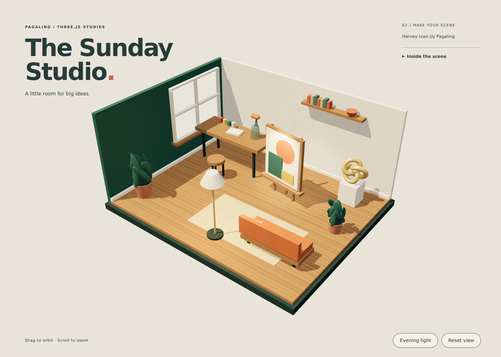

# M2 Q2 - PAGALING

**The Sunday Studio** · Harvey Ivan Uy Pagaling

A new art studio created for **Make your Scene**, separate from the M1 bedroom project. All 90 mesh objects use built-in Three.js geometries; no 3D models are imported.

## Requirements

| Requirement | Implementation |
| --- | --- |
| At least 3 materials | MeshStandardMaterial for surfaces, MeshPhongMaterial for brass, MeshPhysicalMaterial for glass; MeshBasicMaterial for the window and bulb |
| At least 3 different lights | HemisphereLight, DirectionalLight, PointLight, SpotLight |
| At least 3 textures | Locally generated oak grain, lime plaster, woven canvas CanvasTextures |
| Full-screen scene | Viewport-sized canvas with resize handling |
| Website title | M2 Q2 - PAGALING |
| External JavaScript | js/main.js and js/textures.js |
| Organized files | css/, js/, vendor/three/ |
| No imported 3D objects | All objects made from primitives in the source |

## Run

Open `index.html` using VS Code Live Server, or run `python -m http.server 8000` in this folder and visit http://localhost:8000. On Windows, `py -m http.server 8000` also works. Serve over HTTP because the code uses ES modules. Three.js 0.186.1 is included locally with its MIT license. WebGL 2 is required.

Drag to orbit, scroll to zoom, select **Evening light** to change illumination, and **Reset view** to restore the starting camera. The brass sculpture rotates slowly.

## Files

- index.html: page structure and accessible controls
- css/style.css: full-screen layout and responsive interface
- js/main.js: room geometry, materials, lights, animation, camera interaction
- js/textures.js: deterministic texture generation
- vendor/three/: local Three.js modules and license
- preview.png: actual rendered screenshot

## Validation

Browser tests passed for the title, 90 meshes, material and light types, three distinct texture maps, full-screen rendering at 1400×1000 and 390×844, orbit/reset controls, daylight/evening switching, and sculpture animation. No JavaScript errors or failed requests occurred. The cloud browser used in this chat has WebGL disabled; use a WebGL 2-capable browser to interact with the scene.
